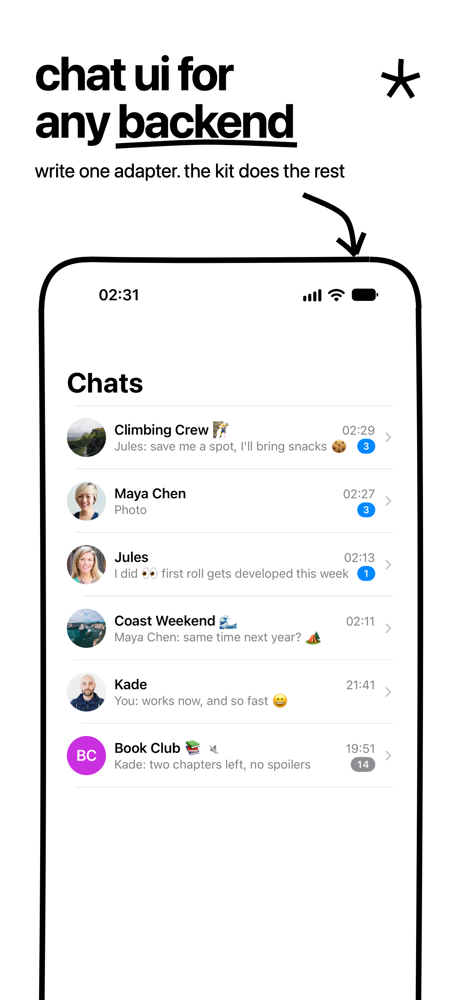
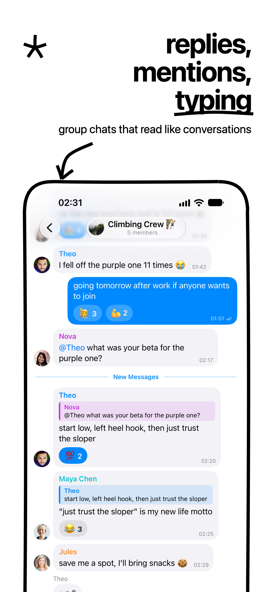
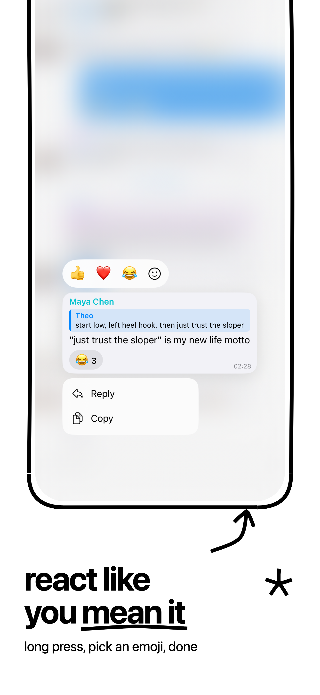
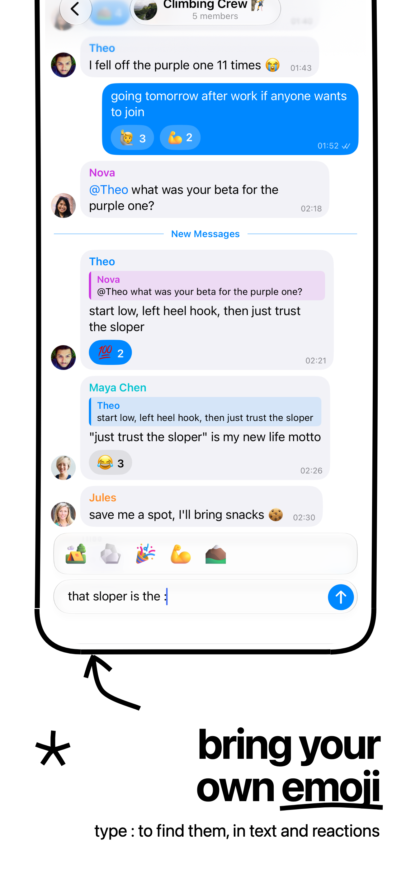
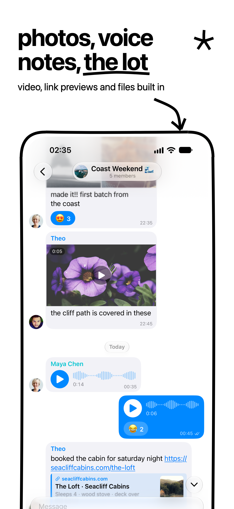
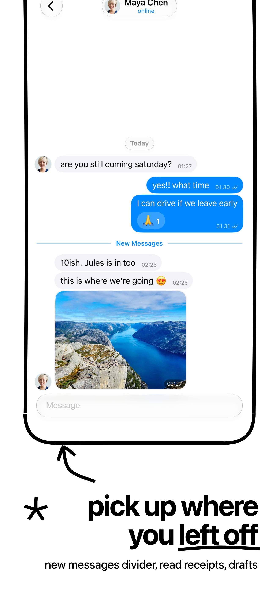
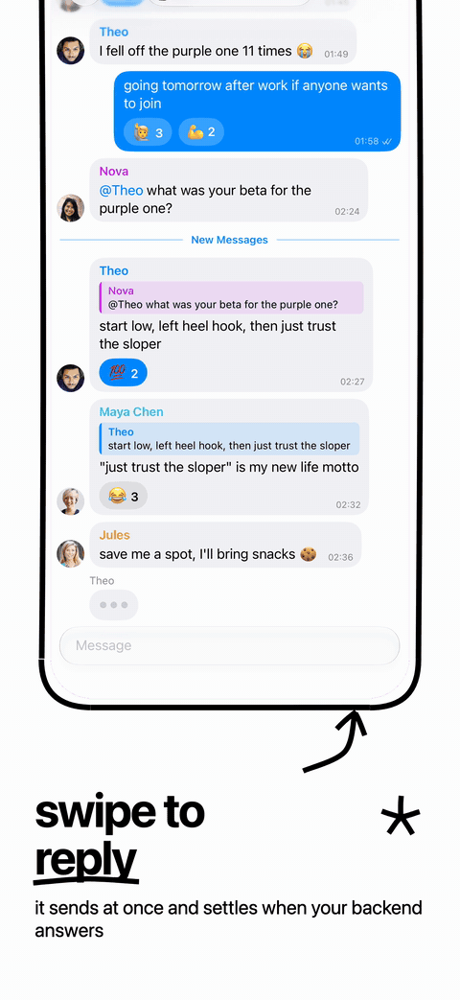
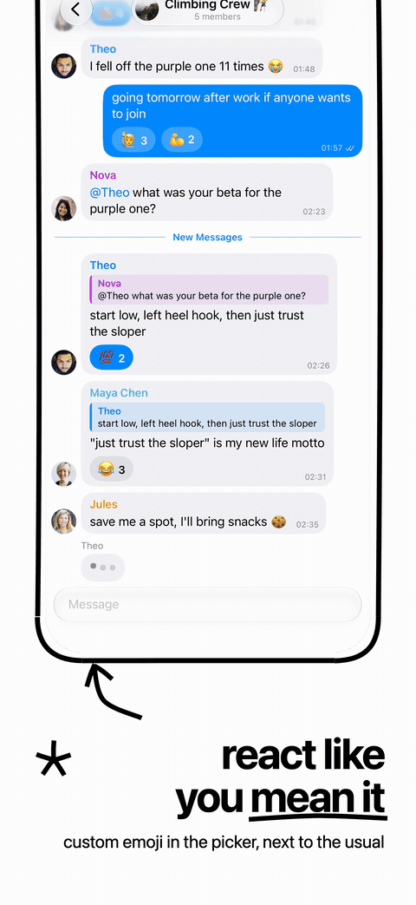
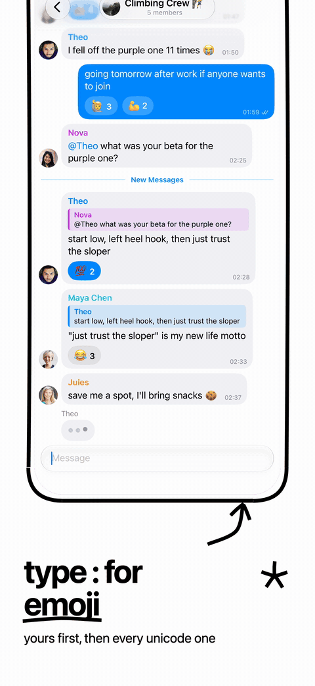
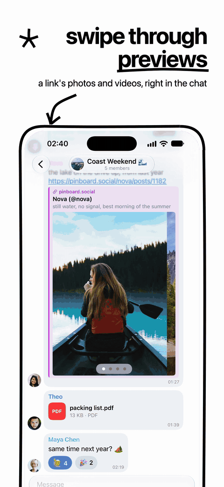

# StupidChatKit

The chat framework from [stupid social](https://github.com/stephancill/stupid-social) as a Swift package: one chat screen and Chats list for any number of networks, with an adapter per network. It knows no network itself.

You get message lists with replies, reactions, mentions, custom emoji, stickers (Lottie and WebM, drawn without dependencies), voice messages, photos, videos and files; optimistic sending and editing; drafts; unread counting and the "New Messages" divider; debounced read markers; snapshots that open a chat with content; search; forwarding across networks; and a merged, cached Chats list. A network adds only what translates between it and the kit: a `ChatAdapter` for a conversation and a `ChatListProvider` for its rows. Optional abilities (editing, deleting, reactions, typing, mentions, stickers, voice, forwarding, a composer menu, stopping in-flight work, …) are separate protocols, and the screen offers each exactly when an adapter adopts it.

iOS 18 or later. `docs/DESIGN.md` has the design.

<p>
  
  
  
  
  
  
</p>

<p>
  
  
  
  
</p>

Every screen above is the kit talking to one made-up backend, `Examples/ChatKitExample` (see Example).

## Install

```swift
dependencies: [
    .package(url: "https://github.com/stephancill/stupid-chatkit", from: "0.1.0"),
],
targets: [
    .target(name: "MyApp", dependencies: [.product(name: "StupidChatKit", package: "stupid-chatkit")]),
]
```

`stupid-app` builds apps with package dependencies from 0.0.27.

## Use

A chat with a bot that repeats what you send:

```swift
import StupidChatKit
import SwiftUI

struct ContentView: View {
    var body: some View {
        NavigationStack {
            NetworkChatView(viewModel: AdapterChatViewModel(adapter: EchoAdapter(), accountId: "demo"))
        }
    }
}

@MainActor
final class EchoAdapter: ChatAdapter {
    let network = ChatNetwork(rawValue: "echo")
    let key = "echo:bot"
    let canReply = true
    let acceptsAttachments = false
    let pollInterval: Duration? = nil
    var onChange: (() -> Void)?
    let info = ChatInfo(title: "Echo Bot", subtitle: "repeats you")
    private(set) var messages: [ChatMessage] = []
    let reactions: [String: [ChatReaction]] = [:]
    let hasEarlierMessages = false

    private let bot = ChatUser(id: "bot", name: "Echo Bot", avatarURL: nil)
    private let me = ChatUser(id: "me", name: "Me", avatarURL: nil)

    func loadNewest() async throws {
        guard messages.isEmpty else { return }
        messages = [ChatMessage(id: "1", sender: bot, timestamp: Date(), text: "Say something", isOwn: false)]
    }

    func loadEarlier() async throws {}

    func send(_ message: ChatOutgoing) async throws -> String? {
        let id = UUID().uuidString
        messages.append(ChatMessage(id: id, sender: me, timestamp: Date(), text: message.text, replyToId: message.replyToId, isOwn: true))
        messages.append(ChatMessage(id: UUID().uuidString, sender: bot, timestamp: Date(), text: message.text, isOwn: false))
        onChange?()
        return id
    }

    func isAfterReadPosition(_: ChatMessage) -> Bool { false }
    func markRead(upTo _: ChatMessage) -> (@MainActor () async throws -> Void)? { nil }
    func reactors(of _: String, on _: String) -> [ChatReactor] { [] }
    func snapshot() -> Data? { nil }
    func restore(snapshot _: Data) {}
}
```

At launch, tell the kit what it can't know (each is optional):

```swift
ChatKit.onEvent = { event in /* usage metrics */ }
ChatKit.networkIcon = { network, size in AnyView(MyNetworkIcon(network, size: size)) }
ChatKit.openAppLink = { url, base in MyRouter.open(url) }
```

For a Chats list, define your destination type (your id for a chat on any network), conform each network to `ChatListProvider`, and drive your list with `ChatListViewModel<Destination>(sources:)`. `Examples/ChatKitExample` is a small example and stupid social's `ChatsView` a full one.

## Example

`Examples/ChatKitExample` is an app on one in-memory backend: `DemoChatAdapter` (reactions, custom emoji, voice playback, read receipts, typing, mentions and editing), `DemoChatListProvider`, and a plain SwiftUI list on `ChatListViewModel`. Swap `DemoBackend` for your API client and the rest stays. It depends on this checkout by path. Run it with `stupid-app`:

```bash
cd Examples/ChatKitExample
stupid-app run --simulator
```

The README's screenshots and GIFs come from it, captured on an iPhone 16 Pro Max simulator and framed with the stupid style from `docs/screenshots/spec.json`.

## Develop

```bash
xcodebuild test -scheme StupidChatKit -destination 'platform=iOS Simulator,name=<simulator>'
```

The tests (`Tests/StupidChatKitTests`) cover the framework with fake adapters and providers. Sticker rendering is checked against references on a corpus of real stickers: `scripts/lottie-compare.py` against Telegram's rlottie and `scripts/webm-compare.sh` against ffmpeg; run them after changing `Sources/StupidChatKit/Stickers/`.

To work on the kit from an app, point the app's dependency at a local checkout (`.package(path: "../stupid-chatkit")`) while you work, then tag a release and pin it.

## License

Apache 2.0 (`LICENSE`). Bundled data and ported code are listed in `THIRD_PARTY_NOTICES.md`.
